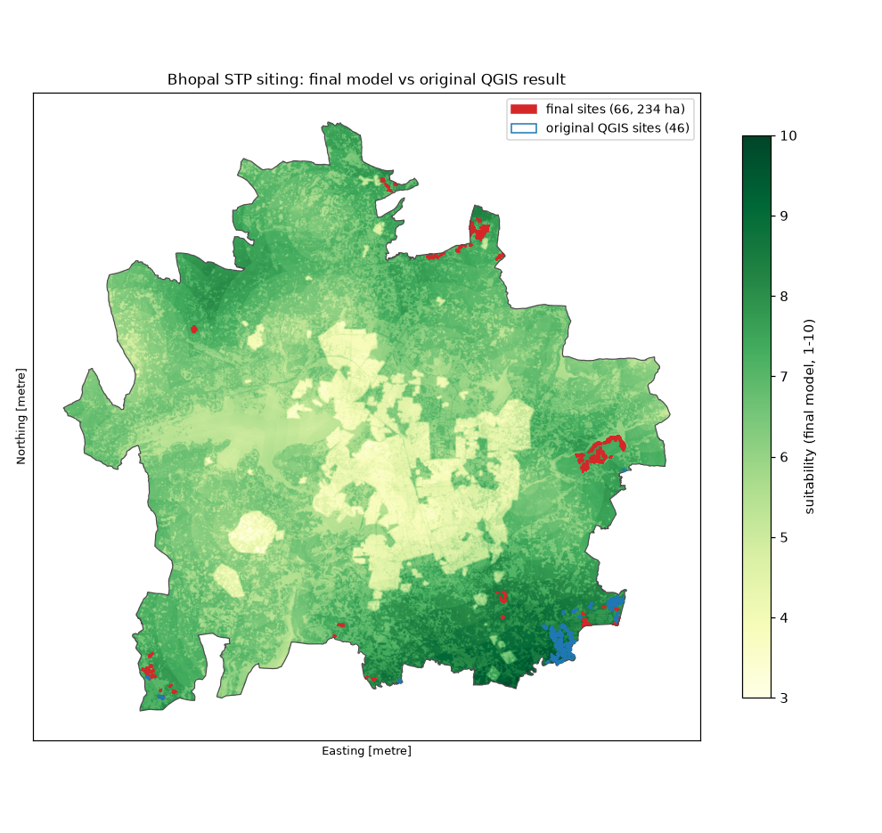
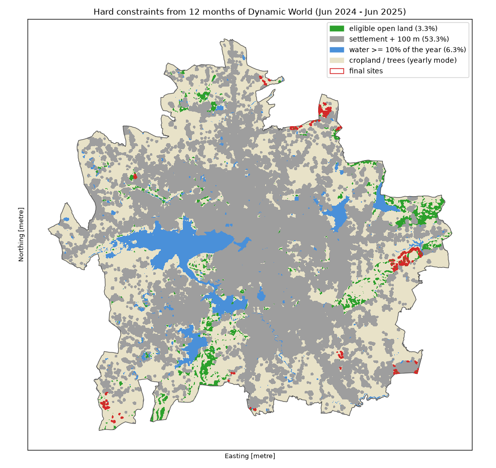

# Bhopal STP Siting

Where could Bhopal, the "City of Lakes", put its **decentralised sewage treatment plants (STPs)**? This project answers that with a multi-criteria GIS analysis of Sentinel-2 imagery, an ALOS PALSAR elevation model, OpenStreetMap and Google Dynamic World.

It started as a QGIS coursework analysis. This repo **rebuilds that analysis as a reproducible Python pipeline, reproduces the QGIS result exactly, and then uses the pipeline to find and fix the analysis's weaknesses**. The final model selects **66 sites (234 ha) on open, non-agricultural land**, away from settlements, schools, hospitals and lakes.



## Result

| | Original QGIS analysis | Final model |
|---|---|---|
| Sites | 46 (125 ha) | **66 (234 ha)** |
| Weights | asserted | **AHP** (pairwise judgements, consistency ratio 0.0099) |
| Selection rule | suitability ≥ 8 | best eligible land, same land budget as the top 0.34% of the city |
| Land-cover check | single-date K-Means "barren" class | **hard constraints from 12 months of Dynamic World** (no cropland, trees, settlements, water) |
| Independent land-cover verdict | not assessed | 35 of 66 open land, 31 uncertain, **0 built-up** |
| Robust to ±20% weight changes | not assessed | **51 of 66 sites** in ≥ 90% of 300 random draws |
| Road access (drivable network) | not assessed | all sites reach a major road; median 1.9 km |

Per-site details (suitability, slope, elevation range, distances to schools, hospitals, lakes and roads, robustness, land-cover evidence) are in the site table produced by `python -m stp.cli sites` / `network` / `crosscheck`, and a pre-filled field-check sheet is in [`review/`](review/README.md).

## How the project evolved

1. **Exact reproduction.** Every QGIS step was rebuilt in Python and checked pixel by pixel against the QGIS outputs. Missing parameters were recovered from the QGIS processing history and the data itself. The pipeline reproduces the suitability map **exactly** (all 8.1 M pixels) and the 46 final sites with **0 m²** of geometry difference. Details: [`docs/qgis_workflow.md`](docs/qgis_workflow.md), [`docs/parity.md`](docs/parity.md).
2. **What the reproduction revealed.** Having the analysis in code made its weak points measurable:
   - The K-Means land-cover map is **one of many equally likely partitions**: changing only the random seed moves agreement with the original between 76% and 99%.
   - The fixed "≥ 8" cut-off sits at the top of a surface that peaks at 8.48. With the land cover corrected, **±20% weight changes swing the result between 25 and 101 sites** (5–95% of 300 draws), only 14 of 59 sites survive in ≥ 90% of draws, and ~4,700 pixels sitting exactly on 8.0 were decided by floating-point rounding.
   - A first version of the final model (AHP weights, capped residential criterion, top-% rule) still picked mostly bad land: independent products put **36 of its 44 sites on farmland and 6 on built-up land**, and a visual check found sites inside villages that OpenStreetMap doesn't map. The "barren" class was largely fallow fields.
   - The residential criterion rewarded distance from homes all the way to 9 km, which suits a centralised plant rather than a decentralised one.
3. **Final model.** Each weakness was addressed with a sourced or tested change (below), and the result was re-validated.

## Final model

**Criteria and weights.** Seven criteria, each scored 1–10 with GRASS's integer-input rescale (recovered exactly from the QGIS outputs). Weights come from an AHP pairwise comparison ([`docs/ahp_questionnaire.md`](docs/ahp_questionnaire.md)):

| Criterion | Direction | Weight |
|---|---|---|
| Distance from lakes and water bodies | farther is better | 0.333 |
| Distance from residential areas | farther is better, **capped at 100 m** | 0.215 |
| Distance to natural drainage (effluent outfall) | closer is better | 0.129 |
| Land cover (K-Means, 4 classes) | barren best | 0.129 |
| Distance to roads | closer is better | 0.074 |
| Elevation (gravity flow) | lower is better | 0.074 |
| Slope | flatter is better | 0.046 |

**Constraints applied before ranking** (from all 141 Dynamic World images, June 2024 – June 2025):



- Land cover: the yearly most common class must be grass, scrub or bare. A fallow field is labelled cropland in other seasons, which a single June image can't show.
- Settlements: built in ≥ 50% of observations, plus a 100 m buffer.
- Flood proxy: water in ≥ 10% of observations.
- Exclusions kept from the original: 500 m around schools and hospitals.

Together these leave **3.3% of the city** eligible.

**Selection.**
- From eligible land, take the best-scoring pixels, as many as the top 0.3395% of the city (~275 ha).
- Require road access (road score ≥ 7).
- Subtract the 500 m school/hospital buffers, *then* keep sites of at least the required plant area.

**Sources for the numbers.**

| Parameter | Value | Source |
|---|---|---|
| Residential cap | 100 m | CPHEEO *Manual on Sewerage and Sewage Treatment Systems* (2013), Part A, ch. 5: 100 m from odour-producing units to habitation without deodorisation, as quoted in a CPCB reply to the National Green Tribunal |
| Plant capacity | 12.7 MLD | Mean of the six AMRUT 2.0 Package 3 plants in Bhopal (32, 14, 13, 10, 6, 1 MLD; *Indian Infrastructure*, 2025-01-27) |
| Land per MLD | 0.044 ha | Largest of three measured Indian plants (MBR 4.5 MLD on 2,000 m²; SBR 3 MLD on 700 m²; MBBR 1 MLD on 400 m²; Saxena, *Assessment of latest technological solutions in wastewater treatment*, SuSanA) |
| Minimum site area | 0.56 ha | 12.7 × 0.044 |

## Validation and robustness

- **Weight sensitivity:** 300 random draws, each weight × U(0.8, 1.2). Sites per draw 59–68 (5–95%); location overlap with the baseline (IoU) median 0.906, 5th percentile 0.811. 58 of 66 sites survive in ≥ 75% of draws. This stability is partly a ceiling effect: the top tier is saturated on the capped residential, lake-distance and land-cover scores.
- **Independent land cover** (`python -m stp.cli crosscheck`). Of the 66 sites:
  - ESA WorldCover 2021: 62 open land.
  - Esri/Impact Observatory 2023: 35 open land.
  - The single June Dynamic World scene: 12 open land, but that scene is the source shown to confuse fallow fields with open land.
- **Visual check:** Claude labelled each site from Sentinel-2 chips (10 m): 9 clearly usable, 2 not (S35 and S43 sit on a facility with regular parallel rows), 55 uncertain. The [`review/`](review/README.md) sheet is ready for a high-resolution check.
- **Road access:** all 66 sites reach a major road on the drivable OSM network (osmnx; one-way streets respected). Median last mile to a drivable junction: 276 m.
- **Safety checks in code:**
  - every site is ≥ 499 m from any school or hospital (closest: 564 m and 610 m);
  - the sensitivity baseline must match the selected sites exactly;
  - the review sheet refuses to overwrite filled-in answers.

## Limitations

- OSM maps only part of Bhopal's housing. The Dynamic World settlement mask now covers this, but it is coarse at 10 m.
- The flood proxy doesn't capture narrow riverbanks. No sourced riparian setback distance was found, so riverside sites are flagged in the review sheet instead.
- Land per MLD rests on three measured plants. The 100 m buffer is quoted from a CPCB filing; the CPHEEO manual itself couldn't be retrieved.
- About 31 sites remain uncertain between open land and occasionally cropped land; the review sheet is meant to resolve them.
- OSM land use is no help as a site check. Mapped land use covers only 15% of the city (mostly residential; just 7 farmland polygons), and none of it touches any of the 66 sites (nearest polygon 124 m, median 3.1 km). The check reads a local OSM extract because the public Overpass API was at capacity and asks automated users not to use it.

## Running it

```bash
conda env create -f environment.yml
conda activate stp
python scripts/check_env.py
```

Edit the data paths in `config.yaml`. Then:

```bash
python -m stp.cli phase1        # band stack, indices, DEM, slope (+ QGIS parity)
python -m stp.cli phase2        # distance rasters
python -m stp.cli phase3        # K-Means land cover (original + corrected)
python -m stp.cli phase4        # scores and weighted overlay
python -m stp.cli phase5        # site selection (reproduces the 46 QGIS sites)
python -m stp.cli final         # final model (needs an Earth Engine project for Dynamic World)
python -m stp.cli sensitivity   # weight sensitivity
python -m stp.cli sites         # per-site statistics and ranking
python -m stp.cli network       # drivable-network access (osmnx, one cached download)
python -m stp.cli crosscheck    # WorldCover, Esri IO, Dynamic World per site + image chips
python -m stp.cli crosscheck-osm  # OSM land-use overlap (local .osm.pbf extract, see config.yaml)
python -m stp.cli review        # field-check sheet
```

`python -m pytest` runs the unit tests (synthetic data; no downloads; also run in GitHub Actions with ruff). `PROGRESS.md` is the step-by-step log, and `docs/parity.md` has every finding with its evidence.

**Apps:**
- `streamlit run apps/dashboard/app.py`: explore the final sites. Includes filters (robust only, minimum area, land-cover verdict, road access), a map, a table and a chart. Needs the outputs of `final`, `sites`, `network` and `crosscheck`.
- `apps/auto_stp/`: the original GEOTA web app (FastAPI + Streamlit), ported. Draw any area; it applies the final model's Dynamic World rules, the slope limit, the OSM exclusions and the plant footprint. See its [README](apps/auto_stp/README.md) for what was fixed.

**Layout:**
- `src/stp/`: the pipeline.
- `scripts/`: diagnostics behind each finding.
- `tests/`: unit tests.
- `docs/`: workflow, parity log, AHP questionnaire, figures.
- `review/`: the site-check sheet.
- `apps/`: the dashboard and web app.

## Data sources

- Sentinel-2 MSI L2A, tile T43QGF, 9 June 2025: [Copernicus Data Space Ecosystem](https://dataspace.copernicus.eu/)
- ALOS PALSAR RTC DEM (AP_04940_FBS_F0450_RT1): [ASF DAAC](https://search.asf.alaska.edu/)
- Roads, water, drainage, land use, schools, hospitals, drivable network: © [OpenStreetMap contributors](https://www.openstreetmap.org/copyright) (ODbL). The land-use cross-check uses the [OpenStreetMap France Madhya Pradesh extract](https://download.openstreetmap.fr/extracts/asia/india/) of 2026-10-21
- Planning boundary 2031: [Bhopal Planning Boundary 2031](https://github.com/datameet/Municipal_Spatial_Data/blob/master/Bhopal/Planning_%20Boundary_%202031.geojson) by [DataMeet India community](http://datameet.org/) ([CC BY 4.0](https://creativecommons.org/licenses/by/4.0/))
- [Google Dynamic World V1](https://dynamicworld.app/), via Google Earth Engine
- [ESA WorldCover 10 m 2021 v200](https://esa-worldcover.org/)
- [Esri / Impact Observatory 10 m annual land cover](https://planetarycomputer.microsoft.com/dataset/io-lulc-annual-v02), via Microsoft Planetary Computer

Data is not included in this repo; check each provider's licence before reuse.
